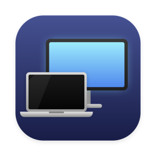

<p align="center"></p>

# ClamshellLite

[](https://github.com/kelvilee/clamshell-lite/actions/workflows/ci.yml)

ClamshellLite is a menu bar app for MacBooks. When you connect an external display, the app turns off the built-in display. The lid stays open. Windows, the Dock, and the cursor move to the external display. When you disconnect the last external display, the app turns the built-in display on again.

## Requirements

- A MacBook with macOS 14 (Sonoma) or later.
- Apple Command Line Tools (Swift 6 or later). You do not need Xcode.

To install the Command Line Tools, run:

```sh
xcode-select --install
```

To make sure that Swift is available, run:

```sh
swift --version
```

## Install

1. Get the source code:

   ```sh
   git clone https://github.com/kelvilee/clamshell-lite.git
   cd clamshell-lite
   ```

2. Build the app:

   ```sh
   ./build.sh
   ```

   The script builds `build/ClamshellLite.app` and signs it with an ad-hoc signature.

3. Move the app to your Applications folder:

   ```sh
   mv build/ClamshellLite.app /Applications/
   ```

4. Start the app:

   ```sh
   open /Applications/ClamshellLite.app
   ```

   A laptop icon appears in the menu bar. The app does not show in the Dock.

You build the app on your own Mac, so Gatekeeper does not block it. If you copy a built app from a different Mac, Gatekeeper can block it. In that case, right-click the app in Finder, select **Open**, then select **Open** again.

## Start at login

1. Click the laptop icon in the menu bar.
2. Turn on **Launch at login**.

macOS can ask you to approve the app. If the toggle stays off, open **System Settings > General > Login Items** and allow ClamshellLite.

When you rebuild the app, macOS can reset this approval. If this occurs, turn on **Launch at login** again.

## Use

Click the laptop icon in the menu bar to see these items:

| Item | Function |
|---|---|
| Built-in display: on / off | Shows the current state. |
| Auto-disable built-in display | Turns the automatic behavior on or off. The default is on. |
| Restore built-in display | Turns the built-in display on and turns Auto off. |
| Launch at login | Starts the app when you log in. |
| Quit ClamshellLite | Turns the built-in display on, then quits. |

The icon shows a laptop with a slash when the built-in display is off.

## If the built-in display stays off

Do one of these steps:

- Connect an external display, then select **Restore built-in display** in the menu.
- Log out or restart. The app changes the display only for the current session.
- If you can use Terminal, run:

  ```sh
  defaults write local.ClamshellLite autoEnabled -bool false
  open /Applications/ClamshellLite.app
  ```

  When the app starts, it turns the built-in display on.

## Update

```sh
cd clamshell-lite
git pull
osascript -e 'quit app "ClamshellLite"'
./build.sh
rm -rf /Applications/ClamshellLite.app
mv build/ClamshellLite.app /Applications/
open /Applications/ClamshellLite.app
```

## Uninstall

1. Click the laptop icon, then select **Quit ClamshellLite**.
2. If you turned on **Launch at login**, remove ClamshellLite from **System Settings > General > Login Items**.
3. Delete the app and its settings:

   ```sh
   rm -rf /Applications/ClamshellLite.app
   defaults delete local.ClamshellLite
   ```

## Limits

- The app uses a private macOS function (`CGSConfigureDisplayEnabled`). A future macOS update can stop it from working. The app is not available in the App Store for this reason.
- The app counts Sidecar (iPad), AirPlay, and virtual displays as external displays.
- The app does not close the lid or prevent sleep. For lid-closed use, macOS clamshell mode needs a power adapter, an external display, and a keyboard.
- The app is tested on Apple Silicon only.

Use the app at your own risk. The software has no warranty. Read [LICENSE](LICENSE) for the full terms.

## Development

Run the tests:

```sh
swift test
```

Project layout:

| Path | Contents |
|---|---|
| `Sources/ClamshellCore` | The decision logic. It has no macOS dependencies, so the unit tests can use fakes. |
| `Sources/ClamshellLite` | The menu bar app and the CoreGraphics calls. |
| `Tests/ClamshellCoreTests` | Unit tests for `ClamshellCore`. |
| `Icon/make-icon.swift` | Draws the app icon. `build.sh` runs it. |

## Contributing

Bug reports and pull requests are welcome. For a bug report, include your Mac model, your macOS version, and the steps that cause the bug. For a pull request, make sure that `swift test` passes.

## License

ClamshellLite is available under the [MIT License](LICENSE).

